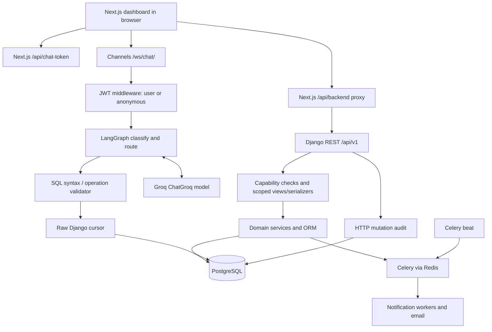
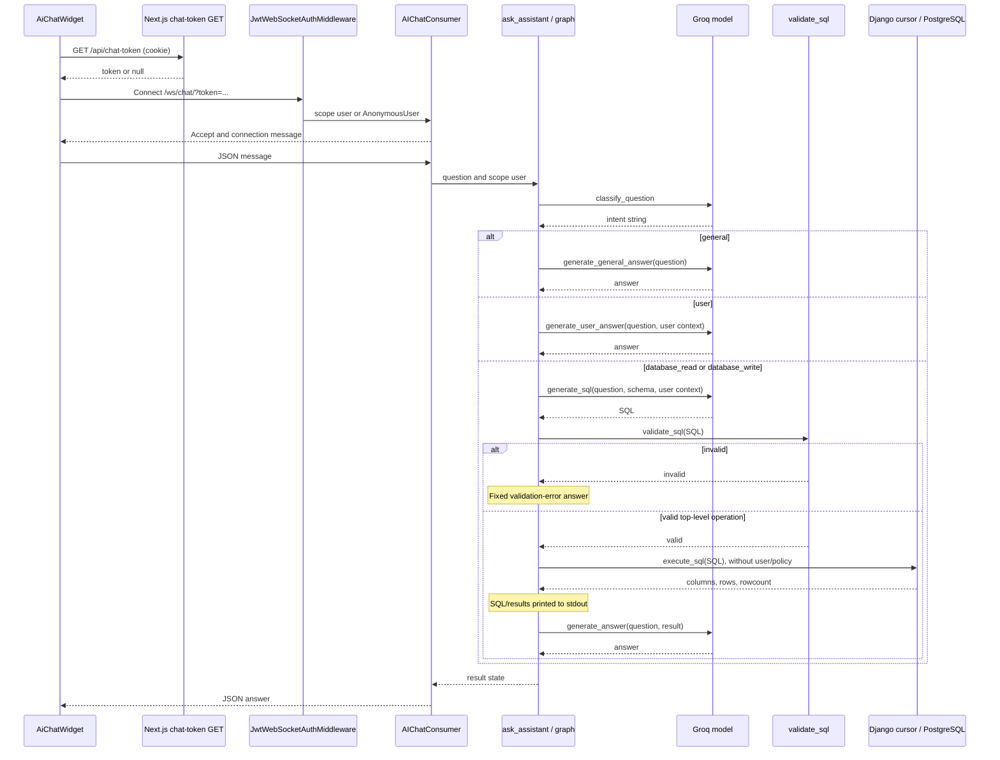

# HMS AI Architecture and Permissions Audit

Date: 27 October 2026. Scope: repository investigation and documentation only.

Evidence labels used below: **Implemented** means reachable in source, not verified running in production; **confirmed gap** means demonstrated by source or an isolated, non-database check; **potential risk** requires deployment or policy confirmation; **proposed** means not implemented. Line references refer to the source reviewed for this report.

Investigation covered first-party backend/frontend source, routes, models, migrations, fixtures, dependency manifests, tests, and architecture/deployment documents. Searches excluded dependency trees and generated assets. No application code was changed. No packages were installed, migrations run, environment variables changed, live records queried, or LLM requests sent. Secret environment files were not read. The only execution beyond inspection was a pure SQL-validator check using synthetic SQL strings; no SQL was executed against a database. Database-backed tests were deliberately not run. Actual deployment exposure, database grants, installed production dependencies, and live permission assignments remain unknown.

## 1. Executive Summary

The repository implements a Django REST Framework hospital backend and a Next.js frontend. It supports patient registration, staff invitations, doctor schedules, appointments, medical records, prescriptions, medicine inventory, invoices/payments, notifications, and audit logs. PostgreSQL is the configured application database; Redis supports Celery jobs.

An AI assistant already exists. The dashboard opens a WebSocket to Django Channels, which invokes a LangGraph workflow. A Groq-hosted model classifies questions and either answers directly or generates PostgreSQL SQL. Both read and write intents reach the same SQL execution function using the ordinary Django database connection.

**The safest starting point is securing this existing execution path, before adding embeddings.** The WebSocket middleware attaches an anonymous user when credentials are missing or invalid, and the consumer accepts that connection. No AI node checks the hospital's authorization rules. The SQL validator permits SELECT, INSERT, UPDATE, and DELETE, checking only parseability, statement count, and the top-level operation. It does not enforce table, column, patient, ownership, or permission restrictions.

The hospital already has a reusable permission catalog: **44 permissions in 11 fixture categories**, with codes, names, and descriptions. Its runtime authority is `CustomUser.has_permission()`, backed principally by direct user grants, with explicit active-ADMIN and superuser bypasses. Roles provide templates whose permissions are copied/synchronized into user grants; normal checks do not dynamically union role permissions.

Ordinary REST endpoints generally combine capability checks with ownership-filtered querysets and serializer validation. The AI bypasses all those layers, including workflow rules and HTTP audit logging. Some ordinary API inconsistencies also need review, especially the unrestricted staff account listing under the ownership-limited `can_view_users` permission.

No embeddings, vector database, semantic permission search, persistent AI conversation store, checkpointing, or model-bound domain tools were found. `AGENTIC_CHATBOT_ROADMAP.md` explicitly describes planned work; its future architecture is not implemented evidence. Runtime availability is uncertain: AI/Channels dependencies are absent from `requirements.txt`, the supplied web process is WSGI, and ASGI import ordering needs repair/verification.

## 2. Project Architecture

### Technologies and boundaries

| Component | Repository evidence | Current responsibility |
| --- | --- | --- |
| Python backend | `requirements.txt`; `manage.py`; `config/settings.py:48` | Django 6.0.5, DRF 3.17.1, SimpleJWT 5.5.1, filtering and OpenAPI |
| TypeScript frontend | `frontend/package.json`; `frontend/src/app/` | Next.js 16.2.12, React 19.2.4, Tailwind 4; App Router dashboard and authentication pages |
| REST transport | `config/urls.py:29`; `frontend/src/lib/api-client.ts`; `frontend/src/app/api/backend/[...path]/route.ts:58` | Same-origin browser proxy to `/api/v1/`; JSON and invoice PDF responses |
| AI transport | `config/routing.py:6`; `config/consumers.py:8` | Direct browser WebSocket `/ws/chat/`; synchronous request/final-answer messages |
| AI orchestration | `ai/orchestrator.py:21`; `ai/agent.py:66` | LangGraph and LangChain prompts; Groq model invocation |
| Database | `config/settings.py:173` | PostgreSQL through Django ORM and AI raw cursor; no second application DB configured |
| Background execution | `config/celery.py`; `config/settings.py:247` | Celery, Redis broker DB 0/result DB 1 defaults, database-backed beat scheduler |
| Files | `config/settings.py:223` | WhiteNoise static assets; local filesystem media storage |
| Deployment | `Procfile` | Release migrations/seeding/static collection; Gunicorn WSGI web, Celery worker and beat |

This is a modular backend monolith plus a separately served frontend, not evidence of independent domain microservices. No GraphQL implementation was found. JSON schema metadata is not a database or a vector store. Django session middleware supports the admin surface; REST defaults to JWT.

### Domain modules

| Directory | Models / functions and purpose |
| --- | --- |
| `apps/users/` | `CustomUser`, `Permission`, `Role`, `RolePermission`, `StaffInvitation`; login, profile, roles, grants, staff management |
| `apps/patients/` | `PatientProfile`; self profile and staff patient registry |
| `apps/doctors/` | `DoctorProfile`, `DoctorSchedule`; directory, onboarding and availability |
| `apps/appointments/` | `Appointment`; booking/list/detail/status transitions; `book_appointment`, `cancel_appointment`, `get_available_slots` |
| `apps/medical_records/` | `MedicalRecord`; appointment-linked diagnosis, treatment, notes and attachments |
| `apps/pharmacy/` | `Medicine`, `Prescription`; inventory, prescribing, dispensing and cancellation |
| `apps/billing/` | `Invoice`, `InvoiceItem`, `InvoicePayment`; invoice generation, payment recording and PDF generation |
| `apps/notifications/` | `NotificationEvent`; reminders, cancellation emails and low-stock notifications |
| `apps/audit/` | `AuditLog`; HTTP mutation audit middleware and restricted read APIs |
| `apps/core/` | Permission classes, WebSocket JWT middleware, health endpoint, schema export command and static schema |
| `apps/utilities/` | Timestamp/soft-delete base models, serializer attribution and pagination |
| `ai/` | Prompt-based SQL assistant and LangGraph nodes/state |
| `chat/` | Generated placeholder models/views/tests; not registered as an installed app or exposed by HTTP routes |

No dedicated nurse, laboratory, admission, or discharge application was found. Diagnoses are fields on medical records, not a separate diagnosis service.

`apps/notifications/tasks.py:65–171` defines `discover_upcoming_appointment_reminders`, `send_appointment_reminder`, `send_appointment_cancellation`, and `process_low_stock_notification`. `dispatch_task_after_commit()` (`dispatch.py:9`) queues work after transaction commit. The hourly reminder schedule is enabled only when `NOTIFICATIONS_ENABLED` is true (`settings.py:260–284`, default false). Actual worker/beat execution is unknown. No AI Celery task was found.



The AI branch does not pass through the policy/domain-service branch. The diagram describes source wiring; the Procfile does not itself serve the WebSocket branch.

## 3. Existing AI Components

| Component | Implementation and integration | Status |
| --- | --- | --- |
| Dashboard chatbot | `AiChatWidget`, `frontend/src/components/ai/ai-chat-widget.tsx:30`; mounted in `dashboard/layout.tsx:149` | Implemented; dashboard requires frontend authentication |
| Socket URL/token helper | `getAiChatWebSocketUrl`, `getAuthenticatedAiChatWebSocketUrl`, `frontend/src/lib/ai-chat.ts:11–39` | Implemented; token failure can produce a URL without a token |
| Cookie bridge | `GET`, `frontend/src/app/api/chat-token/route.ts:11` | Implemented; returns existing access cookie to browser memory; no refresh/validation here |
| Consumer | `AIChatConsumer.connect/receive`, `config/consumers.py:8–40` | Wired into ASGI routing; unconditionally accepts connection |
| Graph | `route_intent`, `ask_assistant`, `ai/orchestrator.py:17–131` | Implemented four-way routing, no iterative tool loop |
| Model | `ChatGroq(model_name=DEFAULT_MODEL)`, `ai/agent.py:15,66` | Model identifier `openai/gpt-oss-120b`, served through Groq; no direct OpenAI client found |
| Prompt chains | `CLASSIFIER_PROMPT`, `SQL_PROMPT`, `ANSWER_PROMPT`, `GENERAL_ANSWER_PROMPT`, `USER_ANSWER_PROMPT`; `ai/agent.py` | Implemented synchronous `.invoke()` calls |
| User context | `format_user_context`, `ai/agent.py:880` | ID, names, email, phone, birth date, gender, role codes, optional patient/doctor profile IDs; no permission codes |
| Schema context | `format_schema_for_llm`, `ai/agent.py:22`; import-time JSON loading at line 18 | Static full-schema prompt context, not RAG; snapshot contains stale user relationship metadata |
| Graph nodes | `ai/nodes.py:13–81` | Classify, SQL generation/execution, final/user/general answers, invalid-SQL response |
| SQL guard | `validate_sql`, `ai/sql_validator.py:11` | Implemented syntactic/operation gate; not authorization |
| SQL executor | `execute_sql`, `ai/service.py:4` | Raw application DB cursor, read/write results and `fetchall()` |
| Schema generator | `Command.handle/_collect_tables`, `apps/core/management/commands/extract_schema.py:136` onward | Offline management command; not called per question; Go type metadata does not establish a Go backend |
| Conversation UI state | `messages` React state, widget lines 33,42 | Display-only history; outgoing payload contains only current message |
| Backend state | `AgentState`, `ai/state.py:4`; `graph_builder.compile()`, orchestrator line 113 | Invocation-local question/user/intent/SQL/result/answer; no messages or checkpointer |

`generate_sql(..., query_context="")` (`agent.py:913`) offers a context argument, but `generate_sql_node()` never supplies it. Prompt references to previous turns do not create actual memory. `chat/models.py` contains no conversation model. No persisted response cache, AI result cache, streaming tokens, embedding ingestion, semantic retrieval, function-calling schema, `bind_tools`, or tool registry was found.

The AI code is connected in source rather than merely an unused experiment. Nevertheless, deployment cannot be called active from this audit. `requirements.txt` omits `channels`, `daphne`, `langgraph`, `langchain-core`, `langchain-groq`, `python-dotenv`, and `sqlglot`, despite their imports/configuration. The local environment has sqlglot, which does not establish reproducible installation elsewhere.

## 4. AI Request Lifecycle

### Common entry and return path

1. `DashboardLayout` renders `AiChatWidget` after the client auth check (`frontend/src/app/dashboard/layout.tsx:89–106,149`). This only restricts the UI.
2. Widget `connect()` (`ai-chat-widget.tsx:55`) calls `getAuthenticatedAiChatWebSocketUrl()`. That helper fetches `/api/chat-token`, adds `?token=` when present, and opens a direct browser WebSocket.
3. `config/routing.py` routes `/ws/chat/` to `AIChatConsumer`. `JwtWebSocketAuthMiddleware.__call__()` validates an `AccessToken`, loads an active user, and attaches `scope['user']`; absent/invalid/expired tokens leave `AnonymousUser` (`apps/core/websocketauth.py:14–43`).
4. `connect()` accepts all connections (`config/consumers.py:10`). `sendMessage()` sends `{message: text}` (`widget:131–138`).
5. Consumer `receive()` parses JSON, checks only whether `message` is truthy, obtains the scope user and invokes `ask_assistant(question, user)` (`consumers.py:18–35`).
6. `ask_assistant()` logs user identity and calls `graph.invoke({'question': question, 'user': user})` (`orchestrator.py:116–129`).
7. `classify_question_node()` calls `classify_question()`; `CLASSIFIER_PROMPT` asks the model for one of four labels (`nodes.py:63`; `agent.py:733,855`).
8. The selected path produces `answer`. Consumer returns `{'type':'answer','message':result['answer']}`; widget `onmessage` appends it to the UI (`consumers.py:37`; widget:82–100).

### All graph branches

| Classifier result | Functions | Database and authorization behavior |
| --- | --- | --- |
| `general` | `generate_general_answer_node` → `generate_general_answer` | Current question sent to model; no hospital SQL. Still available anonymously |
| `user` | `generate_user_answer_node` → `generate_user_answer` → `format_user_context` | Context formatting reads user roles/profile relationships through ORM; no capability check. Anonymous context is a fixed anonymous string |
| `database_read` | `generate_sql_node` → `generate_sql` → `execute_sql_node` | Same execution path as writes; label does not constrain SQL to SELECT |
| `database_write` | Same functions as read path | SQL INSERT/UPDATE/DELETE can run immediately; no authorization or confirmation stage |

For both database paths, SQL generation sends the current question, full static schema and user context to Groq. `validate_sql()` runs before execution. Invalid SQL ends at `sql_validation_error_node()` with a generic denial. Valid SQL is passed unchanged to `execute_sql()`. The cursor returns column names, rows and rowcount; these are printed and sent to the answer model through `generate_answer()`. The answer prompt instructs the model how to interpret reads versus write rowcounts (`agent.py:697–725,867`).

No authorization is performed before records reach the model. No query repair/retry branch is implemented. Unexpected classifier labels, malformed JSON, DB exceptions, and model failures lack a consumer-level recovery envelope. Classification and answer generation are separate LLM calls; successful database processing normally makes three calls: classify, SQL, answer. Direct-answer paths normally make two.



No second AI REST endpoint or AI background execution path was found. Calling `ask_assistant()` or `execute_sql()` directly would also encounter no internal permission guard.

## 5. Authentication and Roles

`CustomUser` extends `AbstractBaseUser` and `PermissionsMixin`, uses unique email as `USERNAME_FIELD`, and is identified by its numeric primary key (`apps/users/models.py:119–156`). Domain profiles have separate IDs; these must not be equated with user IDs.

`LoginView.post()` authenticates email/password via Django and issues SimpleJWT access/refresh tokens (`apps/users/views.py:115–157`). `config/settings.py:124–155` configures JWT authentication, default `IsAuthenticated`, access lifetime 15 minutes, refresh lifetime seven days by default, rotation and blacklisting. Overrides may change these defaults. DRF sets `request.user`; permission classes consume that value. OAuth/API-key user authentication was not found. The Groq service key is model-provider configuration, not hospital user authorization.

The frontend proxy stores tokens in `serenity_access` and `serenity_refresh` HttpOnly cookies, uses Secure in production and SameSite Strict, forwards `Authorization: Bearer ...`, retries once after token refresh on a 401, and removes cookies on logout (`frontend/src/app/api/backend/[...path]/route.ts:13–19,83–154`). Chat deliberately makes the access token readable to frontend JavaScript through its cookie bridge. Logout blacklists the refresh token (`LogoutView.post`, line 176); no mechanism closes/revalidates an already-open backend socket.

Relevant routes under `/api/v1/auth/`: `register/`, `login/`, `logout/`, `token/refresh/`, `profile/`, `change-password/`, `password-reset/`, `password-reset/confirm/`. Public registration/login/reset and invitation acceptance have `AllowAny`; protected profile/password endpoints use `IsAuthenticated`. Public registration fixes the role to PATIENT and copies that role's active permissions (`apps/users/serializers.py:31–49`). Staff invitations create inactive accounts, assign roles/grants, store a token hash and expiry, and activate after password acceptance (`apps/users/service.py:17–113`).

Six seed roles exist: `ADMIN`, `DOCTOR`, `PATIENT`, `RECEPTIONIST`, `PHARMACIST`, `MANAGER`. All except MANAGER are marked system roles in `apps/users/fixtures/role.json`. Users can have multiple roles through `CustomUser.roles`. Active checks apply in `has_role()`, whereas `role_codes` returns codes without filtering active roles. Several visibility functions test DOCTOR before PATIENT; dual-role users get the first branch, not a union of both scopes.

Special privileges are explicitly implemented:

```python
# apps/users/models.py:172–185 (excerpt)
if not self.is_active:
    return False
if self.is_superuser:
    return True
if self.roles.filter(code="ADMIN", is_active=True).exists():
    return True
return self.permissions.filter(code=permission_code, is_active=True).exists()
```

These bypasses apply to arbitrary permission-code strings, including codes absent from the catalog. `get_permission_codes()` enumerates active direct grants only; it is not an exhaustive representation of an administrator's effective access. `create_superuser()` also assigns ADMIN and all currently active permissions (`models.py:93–116`).

Django `has_perm()` and `has_module_perms()` have separate broad behavior: active superusers pass, or an active staff user whose unfiltered `role_codes` contains ADMIN passes (`models.py:187–197`). Consequently inactive ADMIN roles are treated differently between Django admin checks and custom REST checks. `CustomUserAdmin` exposes roles/direct grants and disables adding users (`apps/users/admin.py:7–37`). Standard Django groups/user_permissions restored in migration 0011 are not the custom capability decision source.

## 6. Existing Permission Architecture

### Storage, assignment and enforcement

`apps/users/models.py:12–61` defines `Permission(code, name, description, is_active, created_at)`, `Role`, and unique `RolePermission(role, permission)` pairs. With default Django naming these are `users_permission`, `users_role`, and `users_rolepermission`; direct grants use the `CustomUser.permissions` M2M join table. `UserPermission` at line 64 is an empty placeholder, not an implemented provenance-aware grant model. Migrations 0004, 0010 and 0011 record evolution of custom permissions, user M2M relationships, and restored Django auth fields.

The catalog is `apps/users/fixtures/permission.json` (singular). Top-level category names group arrays of `{code,name,description}`. Categories are not persisted on `Permission`: the seeder iterates `group_name` but stores only permission fields (`seed_permissions.py:39–47`). `role_permission.json` maps role codes to permission-code lists or `all_permissions: true`.

`seed_permissions.Command.handle()` upserts roles and permissions by code and replaces each configured role's permission set (`apps/users/management/commands/seed_permissions.py:9–102`). It does not reconcile existing user grants. `Procfile` invokes it on release, so fixture updates may overwrite role templates without changing existing direct grants.

Runtime semantics:

1. Registration/walk-in creation copy PATIENT template grants (`users/serializers.py:31`; `patients/serializers.py:65`). Invitations copy supplied roles' active permissions unless an explicit permission list is supplied (`users/service.py:18–35`).
2. `CustomUser.has_permission()` checks direct grants, plus explicit administrator bypasses. Role membership alone does not grant the role's capabilities dynamically.
3. `StaffUserUpdateSerializer.update()` sets roles but leaves grants unchanged unless `apply_role_defaults` or an explicit permission list is supplied (`users/serializers.py:348–364`).
4. `RolePermissionUpdateView.put()` changes only the role template (`users/views.py:542–556`). `RolePermissionSyncView.post()` invokes `apply_role_permissions_to_users()` separately (`649–663`). Synchronization is additive unless `remove_stale` is requested.
5. Helpers `grant_role_permissions`, `revoke_role_permissions`, `grant_permission_to_user`, and `revoke_permission_from_user` exist, but no external call sites were found. `reconcile_user_permissions` is used by the sync helper. Because direct and copied grants share one M2M, their origin cannot be distinguished; stale removal can remove manual grants too.
6. `HasCustomPermission.has_permission()` reads `required_permission`, `required_permissions`, or method-specific requirements, denies empty requirements and requires **all** declared codes (`apps/core/permissions.py:4–44`). No equivalent AI call exists.

Routes under `/api/v1/staff/` expose permission listing (`permissions/`), roles (`roles/` and `roles/<code>/`), role permission replacement and sync, staff users, and invitations (`apps/users/urls.py`). Catalog listing requires `can_view_permissions` and returns active codes/names/descriptions (`PermissionListView`, `views.py:564`; `PermissionSerializer`, `serializers.py:202`). No permission-create API was found; creation is handled by seeding/ORM, rather than a second AI catalog.

### Complete fixture inventory

| Fixture category | Actual permission codes |
| --- | --- |
| User Management | `can_view_users`, `can_view_all_users`, `can_create_users`, `can_edit_users` |
| Role Management | `can_view_roles`, `can_create_roles`, `can_edit_roles`, `can_assign_roles` |
| Permission Management | `can_view_permissions`, `can_assign_permissions` |
| Patient Management | `can_view_patients`, `can_view_all_patients`, `can_create_patients`, `can_edit_patients` |
| Doctor Management | `can_view_doctors`, `can_view_all_doctors`, `can_create_doctors`, `can_edit_doctors`, `can_manage_doctor_schedules` |
| Appointment Management | `can_view_appointments`, `can_view_all_appointments`, `can_create_appointments`, `can_confirm_appointments`, `can_cancel_appointments`, `can_complete_appointments` |
| Medical Record Management | `can_view_medical_records`, `can_view_all_medical_records`, `can_create_medical_records`, `can_edit_medical_records` |
| Medicine Management | `can_view_medicines`, `can_view_all_medicines`, `can_create_medicines`, `can_edit_medicines`, `can_deactivate_medicines` |
| Prescription Management | `can_view_prescriptions`, `can_view_all_prescriptions`, `can_create_prescriptions`, `can_dispense_prescriptions`, `can_cancel_prescriptions` |
| Billing Management | `can_view_invoices`, `can_view_all_invoices`, `can_create_invoices`, `can_record_invoice_payments` |
| Audit Management | `can_view_audit_logs` |

Representative descriptions, copied from the fixture:

| Code / name | Description |
| --- | --- |
| `can_view_patients` / Can View Patients | Allows viewing patient profiles permitted by ownership rules. |
| `can_view_all_patients` / Can View All Patients | Allows viewing all patient profiles. |
| `can_create_medical_records` / Can Create Medical Records | Allows creating medical records for assigned completed appointments. |
| `can_dispense_prescriptions` / Can Dispense Prescriptions | Allows dispensing pending prescriptions and deducting medicine stock. |
| `can_record_invoice_payments` / Can Record Invoice Payments | Allows recording payments against outstanding invoices. |
| `can_view_audit_logs` / Can View Audit Logs | Allows viewing immutable API audit records. |

No nurse, laboratory-result, admission, discharge, or separate diagnosis permission exists in this catalog. Hospital administration is represented through users/roles/permissions/audit and ADMIN. Catalog presence is not proof of endpoint implementation: for example, no medical-record editing route was found despite `can_edit_medical_records`.

The supported classification is **role-templated capability access plus direct user grants and explicit object/relationship restrictions**. RBAC is present, but not pure dynamic RBAC. Record ownership, assignment, active flags and appointment status are contextual predicates; there is no general ABAC policy engine. `IsAppointmentOwner` implements object-level authorization. No department/ward/tenant policy or database RLS definition was found.

## 7. Database Access Controls

Authentication does not generally grant access to all records. REST views enforce capability checks before handlers, then commonly scope querysets or validate relationship ownership. These rules are distributed across views, serializers and services rather than a central repository/policy layer.

| Resource | Ordinary REST controls | Scope / notable limits |
| --- | --- | --- |
| Patients | `PatientListCreateView`, `PatientDetailView`, `PatientProfileView`; `apps/patients/views.py:41,105,157` | Registry/detail require all-patients capability; self route fetches `user=request.user`. Detail PATCH additionally requires edit capability |
| Doctors | `DoctorDirectoryBaseView.get_queryset`, `apps/doctors/views.py:25`; schedule base at 153 | Base view capability; all-doctors bypasses active/available directory filter. Schedule management limited to own doctor unless all-doctors capability |
| Appointments | `AppointmentListView.get_queryset`, `api_views.py:80`; `IsAppointmentOwner`, `core/permissions.py:47` | All-appointments or assigned doctor/own patient. Detail/cancel/confirm explicitly call object permissions. Completion always filters assigned doctor (`views.py:106`) |
| Appointment creation | `AppointmentCreateSerializer.create`, `serializers.py:38` | All-patients capability permits choosing a patient; otherwise current user's patient profile. Booking service validates slots |
| Medical records | `MedicalRecordVisibilityMixin`, `views.py:38`; `MedicalRecordCreateSerializer.validate_appointment`, `serializers.py:18` | All-records or assigned doctor/own patient; otherwise empty. Creation requires completed appointment and assigned doctor |
| Medicines | `MedicineListView.get_queryset`, `pharmacy/views.py:59`; detail at 175 | View-medicines required; active-only unless view-all-medicines; edit/deactivation separately checked |
| Prescriptions | `PrescriptionListView.get_queryset`, `pharmacy/views.py:311`; patient list at 351 | All-prescriptions or assigned doctor/own patient; own-only special patient list. Creation serializer checks record's assigned doctor |
| Dispensing | `PrescriptionDispenseView.post`, `pharmacy/views.py:382` | Any prescription by ID after dispense capability; no patient ownership requirement; service enforces pending status/stock |
| Invoices/PDFs | `InvoiceAccessMixin`, `billing/views.py:33` | All-invoices or own patient invoices; view capability required |
| Invoice/payment creation | `InvoiceCreateSerializer`, `billing/serializers.py:110`; payment view at `billing/views.py:212` | Invoice creation accepts any appointment under create capability. Payment POST accepts any invoice under record-payments capability; GET uses scoped invoice visibility |
| Staff accounts | `StaffUserListView`, `StaffUserDetailView`, `users/views.py:580–640` | GET requires view-users but queries all users, without ownership or view-all-users checks; confirmed mismatch |
| Audit logs | `AuditLogListView/DetailView`, `audit/views.py:31,111` | View-audit capability gives global audit visibility with optional filters |

Some write capabilities intentionally operate globally, such as dispensing and recording payments. The code confirms their breadth; whether that breadth violates intended hospital policy is unknown.

Columns are shaped by serializers, not PostgreSQL column grants demonstrated in this repository. `PatientListSerializer` returns demographic contact fields, whereas `PatientProfileSerializer` includes medical history and insurance (`patients/serializers.py:12–47`). Thus `can_view_all_patients`, seeded for RECEPTIONIST, also permits sensitive profile detail; no separate field-level clinical-history restriction exists there. `MedicalRecordListSerializer` returns diagnosis, treatment, notes and attachment URL (`medical_records/serializers.py:52`). There is no general per-column permission engine.

Active ADMIN/superuser can satisfy capability-based scope expansions. They do **not** bypass all hardcoded ownership constraints: appointment completion and medical-record/prescription creation still require the assigned doctor. Self-profile endpoints remain self scoped. AI tools must preserve these distinctions rather than adding a blanket administrator object bypass.

No migrations define PostgreSQL policies, SQL roles/grants, or per-request DB identities. All application ORM work and AI SQL use `DATABASES['default']`; real database role privileges and externally installed policies are unknown. Raw SQL does not inherit ORM querysets, serializer field selections, model save hooks, soft-delete behavior, or view permissions.

Attachments use ordinary `FileField` storage and `config/urls.py` appends Django development media serving. Authenticated medical-record APIs do not make the attachment URL itself private. Debug-mode media delivery has no record policy; production file-serving configuration is unknown.

## 8. Current AI Authorization Behavior

| Question | Evidence-based answer |
| --- | --- |
| Does AI know the catalog? | It sees schema structures, including permission tables, but no catalog entries/descriptions are loaded for authorization. Seeing table names is not policy knowledge |
| Does it receive identity/roles? | Yes, scope user is passed to graph; formatted context includes identity/role codes. It may instead receive AnonymousUser |
| Does it know effective permissions? | No. `format_user_context` does not call `get_permission_codes` or `has_permission` |
| Does it authorize before reads/writes? | No. Neither SQL node nor executor uses a user permission check |
| Is generated SQL authorized? | No. Validator receives SQL only and checks top-level syntax/type |
| Are existing backend controls reused? | No `HasCustomPermission`, `IsAppointmentOwner`, scoped queryset or authorized serializer path is used by SQL execution |
| Are tools independently authorized? | There is no domain tool registry; the effective generic DB operation is unauthenticated/unauthorized internally |
| Can data reach an LLM before permission checking? | Yes. SQL results enter `ANSWER_PROMPT` with no preceding authorization; user PII also enters user/SQL prompts |
| Can data reach logs? | Yes, SQL and full results are printed; user object and ID are printed |
| Are responses/history scoped? | Responses go to the requesting socket, but retrieved records are not scoped. UI history is local React state; no backend shared conversation/cache found |

The classifier advertises a `user` route for “What permissions do I have?” (`agent.py:749–766`), but the user prompt supplies roles and no permission codes. That response cannot reliably report the current effective grants. It must never become an authorization decision.

Prompt instructions such as “Never use another user's identifiers” or “Never perform an unrestricted UPDATE” are model guidance only (`agent.py:119,387`). They are not enforced by code. An intent label of `database_read` also imposes no operation restriction.

Missing enforcement points are the socket handshake, each incoming message, dispatch into a data operation, the execution boundary, row/field selection, and output assembly. Output filtering alone cannot undo exposure already sent to Groq or printed to logs.

## 9. Embeddings and Semantic Search

**No embedding model, vector store, embedding creation job, vector fields, similarity query, ranking function, threshold, top-k configuration, or permission embedding index was found.** LangChain currently supplies prompts/model integration only. `apps/core/schema.json` is plain metadata inserted into a prompt; it is not retrieval-augmented generation.

Reusable infrastructure includes catalog descriptions, PostgreSQL, Celery for eventual indexing, and LangGraph for orchestration. None establishes that PostgreSQL has a vector extension installed. There is no basis to name a deployed embedding provider or dimension. Adding one would be new work.

The proposed semantic discovery flow is useful **as planning assistance**, with a stronger execution boundary:

```text
Question → requested operation → candidate permission discovery
         → approved operation/tool and explicit scope
         → complete server-defined permission requirements
         → current user.has_permission checks for all requirements
         → object scope + field scope + business validation
         → bounded retrieval/action → authorized result → answer
```

Semantic similarity must neither authorize access nor certify requirement completeness. For example, “show my records” and “show all records” may retrieve nearly identical descriptions, but their record scopes differ. A missed `can_view_all_medical_records` candidate must never lead to an unscoped query. Likewise selecting `can_view_all_medical_records` for a self-record request may create an unnecessary denial or tempt an unjustified access expansion.

Proposed design principles:

- Use the existing permission code as the canonical identity; index code, name, description and optional curated category/scope examples. Keep embeddings as derived data, never grants.
- Identify an approved operation first. Let each operation declare exact required capabilities and its record/field scope; compare semantic suggestions against that contract.
- For self medical-record listing, enforce `can_view_medical_records` and existing patient/doctor visibility. For requested global listing, explicitly require both base view and all-records scope. Do not silently substitute an unrestricted query.
- Retrieve candidates with tunable top-k, lexical/code matching and measured semantic relevance. Tune thresholds on an evaluation set; no defensible numeric threshold exists yet. With only 44 entries, a deterministic catalog/operation baseline may be sufficient before adding vector infrastructure.
- Fail closed or ask a targeted clarification for unknown operations, ambiguous scope, missing mappings or insufficient candidates. A server operation contract may safely identify requirements even when retrieval missed them; the model cannot waive requirements.
- Validate codes against the active catalog before authorization, including for administrators because `has_permission` itself permits arbitrary codes for them.
- Reuse `CustomUser.has_permission()` for grants. Extract/reuse current object predicates in a common backend policy boundary so REST and AI share the same policy; do not implement an AI-only role-to-permission matrix.
- Refresh the catalog index when descriptions/status change, and re-resolve current user permissions at execution. Never cache an authorization decision in an embedding or conversation.

This is an architecture proposal based on the inspected repository, not a library/provider selection or implementation.

## 10. AI Tools and SQL Execution

### What actually executes

There are no individually declared model tools such as `list_my_appointments` or `book_appointment`. The graph invokes Python functions directly. Its effective database capability is generic SQL:

```python
# ai/sql_validator.py:3–8
ALLOWED_OPERATIONS = {"select", "insert", "update", "delete"}

# ai/service.py:4–11
def execute_sql(sql: str):
    with connection.cursor() as cursor:
        cursor.execute(sql)
        if cursor.description:
            columns = [column[0] for column in cursor.description]
            rows = cursor.fetchall()
```

`validate_sql()` parses PostgreSQL through sqlglot, rejects a statement count other than one, and checks `statement.key` against that set. It does not check referenced tables, sensitive columns, subqueries, joins, ownership predicates, function calls, CTE contents, row limits, write targets, or intent/operation consistency. It does not require a WHERE clause on writes. Database-side permissions/constraints may still reject a query, but those are not hospital-user policy enforcement.

Isolated validator results, obtained without importing Django application code or contacting a database:

| Synthetic input | Actual validator result |
| --- | --- |
| `SELECT * FROM medical_records_medicalrecord` | valid, select |
| `UPDATE medical_records_medicalrecord SET notes = NULL` | valid, update |
| `DELETE FROM medical_records_medicalrecord` | valid, delete |
| `SELECT 1; SELECT 2` | invalid, multiple statements |
| `DROP TABLE audit_auditlog` | invalid, operation not allowed |

These demonstrate the validator's scope, not execution of those operations or an end-to-end exploit. SELECT may also contain expensive/side-effecting functions; actual consequences depend on DB grants. The static schema includes the user password column (`schema.json:2450`) and invitation token-hash metadata, and is not an enforced SQL allowlist. Its `users.CustomUser.role_id` (`2529`) contradicts current M2M roles, so prompt schema is stale.

`execute_sql()` has no user parameter, no independent validation, no server-side result cap/timeout, and no domain transaction workflow. `fetchall()` materializes all returned rows. Generated DML can bypass booking availability, prescription stock updates, invoice invariants, UUID generation in model save hooks, notification triggers and auditing. Database constraints still apply; bypass does not imply every arbitrary write will succeed.

### Exact proposed guard locations

| Location | Required responsibility (proposed) |
| --- | --- |
| `JwtWebSocketAuthMiddleware.__call__` / `AIChatConsumer.connect` | Reject anonymous/inactive/invalid sessions; validate allowed origin |
| `AIChatConsumer.receive` | Validate message type/size, refresh current principal, bound rate and execution |
| `ask_assistant` / operation dispatch | Trusted user ID, approved operation registry, explicit required-capability/scope resolution |
| Replacement for `execute_sql_node` | Invoke individually authorized domain tools; distinguish read and write policies |
| Tool/service boundary replacing generic `execute_sql` | Enforce all capabilities and object/field scope immediately before DB access; never accept model identity or unrestricted SQL |
| Existing domain services | Preserve invariants and transactions; add shared authorization entry point where callers currently enforce it |
| `generate_answer_node` | Accept only already-authorized/minimized result objects; no unrestricted result redaction as primary security |
| Audit integration | Record actor, operation, permission decision, resource identifiers and outcome without raw clinical text |

Existing service functions are reusable business logic, **not automatically safe AI tools**. For example `book_appointment()` has no actor argument and `cancel_appointment()` uses its actor for notifications without a capability check (`apps/appointments/services.py:49,80`). `dispense_prescription()` and `generate_invoice()` likewise rely on caller authorization. Wrapping them must preserve both the view policy and service invariants.

## 11. Security Findings

Severity describes the impact of the source path if deployed/reachable. A confirmed source gap is not a claim that production was exploited. Findings marked potential need runtime or policy confirmation.

### F01 — Critical — Anonymous AI entry (confirmed gap)

**Evidence:** `apps/core/websocketauth.py:29–43` defaults to anonymous and explicitly preserves that for bad tokens; `AIChatConsumer.connect()` accepts unconditionally (`config/consumers.py:10–11`). `receive()` invokes the graph without an authentication check.

**Impact:** Anyone able to reach a working socket can trigger paid model requests and the unguarded SQL path. The dashboard login gate does not protect the backend URL. Actual public availability is unknown.

**Mitigation:** Reject unauthorized handshakes/messages server-side, validate active identity, and test direct socket connections without the frontend.

### F02 — Critical — Unscoped database reads and writes through AI (confirmed gap)

**Evidence:** `ai/nodes.py:25–38`, `ai/sql_validator.py:3–52`, `ai/service.py:4–22`. No permission/ownership check; isolated validation accepts unrestricted read/update/delete. Both intent labels share this path.

**Impact:** Cross-patient reads, unauthorized mutations and potential account/permission-table modification are possible if corresponding SQL is generated and the DB role permits it. This bypasses REST capabilities, scoped querysets and business invariants. No live exploit was attempted; exact DB privileges are unknown.

**Mitigation:** Disable generic AI DML and replace raw access with approved, independently authorized domain operations. Start with narrowly scoped reads. SQL parsing alone cannot establish authorization; any retained reporting SQL requires an independently constrained execution environment and enforced scope.

### F03 — High — Sensitive results sent to model and stdout before authorization (confirmed gap)

**Evidence:** `ai/nodes.py:20,27,36,58`; `ai/agent.py:867–875,880–910`; `ai/orchestrator.py:117–122`.

**Impact:** Full selected results can enter Groq prompts and logs, including patient data returned by F02. User identity/contact/birth-date context is sent even for many tasks that do not need it. Provider retention and log access are unknown; actual historic disclosure is not asserted.

**Mitigation:** Authorize and minimize before retrieval/model calls; replace raw logging with structured redacted audit events; define provider and log retention/access policies.

### F04 — High — Staff API exposes all accounts under ownership-limited permission (confirmed gap)

**Evidence:** `StaffUserListView.get_queryset()` returns all `CustomUser` records and `StaffUserDetailView.get_object()` looks up any ID, while both GETs require only `can_view_users` (`apps/users/views.py:580–629`). The fixture description limits this code to ownership; PATIENT receives it through registration defaults. `StaffUserSerializer` exposes names, emails, roles, permission codes, active/verified/superuser flags (`serializers.py:287–311`).

**Impact:** With fixture-based patient grants, authenticated patients can enumerate accounts and authorization metadata through the API. `can_view_all_users` exists but is not used here. UI navigation hiding cannot resolve this.

**Mitigation:** Align global account reads with explicit global-view capability; scope ordinary reads to self/permitted accounts and minimize fields. Add API tests for default patient grants.

### F05 — High — Permission changes do not reliably revoke copied grants (confirmed behavior; policy risk)

**Evidence:** `CustomUser.has_permission()` uses direct grants; role changes in `StaffUserUpdateSerializer.update()` only replace grants on explicit request; `RolePermissionUpdateView` only changes templates; sync is separately invoked and additive by default (`users/models.py:172`; `serializers.py:348`; `views.py:547,653`; `service.py:156`).

**Impact:** Removing/deactivating a role or removing one of its template permissions can leave effective user access intact. Conversely `remove_stale=True` can remove legitimate manual grants, because grant provenance is absent. If snapshots are intentional, that must be explicit; automatic revocation must not be assumed.

**Mitigation:** Define grant/revocation semantics, preserve grant origin where necessary, and make role lifecycle changes reconcile atomically under that policy. AI must use current effective authorization rather than interpreting roles itself.

### F06 — High — Broad delegation endpoints lack separate grant authority checks (confirmed boundary gap; intended policy unknown)

**Evidence:** Staff PATCH requires `can_edit_users` and `can_assign_roles` but accepts arbitrary active direct permissions (`views.py:617–640`; `serializers.py:322–360`). Invitation creation requires create-users/assign-roles but also accepts explicit permissions (`views.py:361–377`; `serializers.py:123–136`). Neither requires `can_assign_permissions`; both permit assigning active ADMIN roles. No restriction to the caller's own authority was found.

**Impact:** A custom user granted those capabilities can assign grants or an ADMIN role beyond their current access, including to self through PATCH. This is inconsistent with separately modeled permission-assignment authority unless intentionally considered full delegation power. Default fixtures do not establish that ordinary patients hold the required write capabilities.

**Mitigation:** Explicitly define delegation scope and reserved-role rules; require appropriate assignment authority per changed field and prevent unauthorized self-escalation. Preserve legitimate full-administrator administration.

### F07 — High — Patient attachments can bypass record API controls (confirmed development path; potential production risk)

**Evidence:** `MedicalRecord.attachments` is a filesystem `FileField`; record serializer returns attachment URLs; `config/urls.py` adds `static(settings.MEDIA_URL, document_root=settings.MEDIA_ROOT)` and `settings.py:225–234` uses local file storage.

**Impact:** In debug media serving, possession of a file URL bypasses record permission/ownership checks. Production storage/URL access policy is unknown, so production public exposure is not confirmed.

**Mitigation:** Authenticated downloads or short-lived, authorization-issued file access; private media storage. Test direct attachment access separately from API JSON access.

### F08 — High — Prompt injection has an execution path (potential exploitation; missing boundary confirmed)

**Evidence:** Untrusted questions go into classifier/SQL prompts and model SQL reaches the cursor through the shallow validator (`agent.py:68,733,913`; `nodes.py:25`). Results, including free-text notes, are inserted into the answer prompt (`agent.py:723`).

**Impact:** Malicious requests can attempt to override scope or generate writes; retrieved text can distort answers. No successful adversarial model run was performed. The final answer node does not itself execute tools, so result-text injection does not establish a second SQL execution in the same invocation.

**Mitigation:** Treat model output and database text as untrusted, constrain available operations deterministically, authorize every operation, and test adversarial inputs/results. Prompt instructions are supplementary.

### F09 — Medium — Socket identity is not revalidated during its lifetime (confirmed gap)

**Evidence:** Token/user validation runs once in middleware; `receive()` reuses `scope['user']`. No token expiry/account-disable check or logout revocation hook exists in the consumer (`websocketauth.py:27`; `consumers.py:30`).

**Impact:** An open socket can continue after token expiry or account deactivation. Some role relationships may be queried afresh, but cached user scalar state and absent capability checks remain problematic. No backend conversation cache was found to add another cross-user memory path.

**Mitigation:** Revalidate current active identity and permissions at operation time; enforce socket/session expiry and revocation behavior.

### F10 — Medium — Token URL, origin validation and resource limits (confirmed gaps; deployment impact unknown)

**Evidence:** Token is put in query string (`frontend/src/lib/ai-chat.ts:36`); `config/asgi.py:32` has no OriginValidator/AllowedHostsOriginValidator; consumer lacks message length/rate limits and exception handling; SQL uses `fetchall()` (`service.py:11`). REST throttle configuration does not govern Channels.

**Impact:** Query-string tokens may enter infrastructure logs. Unbounded messages/queries/model calls may exhaust resources. Lack of origin checking permits untrusted origins to initiate connections; it does not prove they can read HttpOnly cookies or steal tokens. F01 independently allows anonymous use.

**Mitigation:** Short-lived single-use socket credentials or a suitable protected handshake, origin allowlist, token-redacted access logs, server-side rate/size/time/result limits and controlled error responses.

### F11 — Medium — AI operations absent from business audit trail (confirmed gap)

**Evidence:** `AuditLogMiddleware.should_log()` only records mutating HTTP methods under `/api/v1/` (`apps/audit/middleware.py:40–44`), while AI uses `/ws/chat/` and raw SQL. `AuditLog.save/delete` immutability is model-level (`audit/models.py:43–49`).

**Impact:** AI mutations evade the ordinary audit mechanism; raw SQL can bypass model-level immutability subject to DB privileges. Stdout SQL logging is not an adequate authorized-action audit.

**Mitigation:** Audit at the operation boundary with safe metadata, consider database enforcement for immutable audit records, and test both REST and AI paths.

### F12 — Medium — Runtime/dependency and schema drift (confirmed inconsistencies; startup outcome untested)

**Evidence:** Required AI/Channels modules are omitted from `requirements.txt`; `Procfile` runs `config.wsgi`. `config/asgi.py:16–17` imports middleware/routing before setting the settings module and calling `get_asgi_application()`. Those imports touch Django auth models. `schema.json:2529` still declares a single role FK absent from current `CustomUser`.

**Impact:** Clean installs or cold ASGI startup can fail, provided deployment command cannot serve chat WebSockets, and stale metadata can produce incorrect SQL. External dependency provisioning/ASGI service might compensate, but is unknown.

**Mitigation:** Reconcile dependency/deployment definitions, initialize Django before model-dependent ASGI imports, and validate curated schema metadata against models. Do not expose more schema merely to solve drift.

### F13 — Medium — Sensitive profile fields share broad patient permission (confirmed scope; intended policy unknown)

**Evidence:** `PatientDetailView` uses only `can_view_all_patients` for GET and returns `PatientProfileSerializer`, including medical-history summary and insurance (`patients/views.py:105–130`; `serializers.py:12–25`). RECEPTIONIST has that capability in the fixture.

**Impact:** A role intended primarily for scheduling can read these clinical/financial profile fields. Whether this is permitted in this hospital needs clarification; it is not evidence that every medical-record endpoint is open.

**Mitigation:** Define approved field sets for scheduling versus clinical care and enforce them consistently in REST and future AI result schemas.

### F14 — Low — Inconsistent effective-role and permission presentation (confirmed gap)

**Evidence:** `role_codes` includes inactive roles; `has_role` filters active ones. Django admin checks and frontend `hasPermission()` use unfiltered ADMIN code, while custom checks require active ADMIN (`users/models.py:158–197`; `frontend/src/lib/auth-context.tsx:130–135`). AI user context omits actual grants.

**Impact:** UI/AI may claim access that backend denies; staff admin semantics differ from custom REST semantics. A future discovery implementation trusting these presentations could make incorrect decisions.

**Mitigation:** Treat backend checks as authoritative, align presentation/role-active semantics, and implement permission explanations from trusted backend data rather than model inference.

### Risks not established as current vulnerabilities

- Semantic permission over-/under-selection is a **future design risk**, because no semantic selector currently exists. Test completeness and unnecessary scope expansion before introducing it.
- Cross-user persistent AI memory and shared response-cache leakage were **not found**: graph invocations are fresh and frontend messages stay in local component state. Logging and unscoped SQL already create concrete exposure paths.
- Excessive PostgreSQL superuser/DDL/filesystem privileges are **unknown**. Shared application connection is confirmed, not its live grants.
- No department/patient assignment policy beyond the described relationship checks should be inferred from hospital terminology.

## 12. Existing Components We Can Reuse

1. **Catalog and canonical codes:** `Permission`, fixture descriptions and `PermissionSerializer`; no duplicate AI permission database is needed.
2. **Authoritative capability evaluator:** `CustomUser.has_permission()` and all-of semantics in `HasCustomPermission`; first resolve catalog validity and clarify administrator behavior.
3. **Identity plumbing:** JWT configuration and middleware user lookup, after closing anonymous and lifetime gaps.
4. **Object scopes:** `MedicalRecordVisibilityMixin`, appointment ownership checks, `InvoiceAccessMixin`, doctor/prescription visibility patterns. These need a shared callable boundary rather than AI-specific reinterpretation.
5. **Business operations:** appointment booking/cancellation, pharmacy dispensing/cancellation, invoice/payment services. Preserve their validations/transactions and add caller-independent authorization around them.
6. **Serialization:** existing limited response shapes and field lists, reviewed for intended clinical visibility; never expose raw ORM models or rows by default.
7. **Orchestration/UI:** LangGraph classifier structure and chatbot transport/UI can host a constrained workflow after security and deployment repair.
8. **Operations infrastructure:** Celery for eventual catalog indexing, existing audit conventions, PostgreSQL for derived metadata if needed.
9. **Existing tests:** `apps/core/test_acceptance.py`, `apps/core/test_api_architecture.py`, domain tests/filter tests, `apps/billing/test_payments.py`, audit and notification tests. These are useful fixtures/patterns, not evidence that AI authorization is covered. No dedicated AI/WebSocket authorization test suite was found.

## 13. Missing Components

- Mandatory, continuously valid AI authentication and a backend chat access policy.
- Shared operation-level authorization preserving capabilities, ownership and field scope.
- Approved tool definitions with deterministic complete permission requirements.
- Safe replacement for unrestricted generated SQL, especially writes.
- Bounded retrieval, trusted output schemas, prompt/log data minimization and operation auditing.
- Clarified role-template/direct-grant revocation semantics and delegation boundaries.
- Permission-aware operation planning, candidate validation and ambiguity handling.
- Embedding/index pipeline, model/store choice, versioning and relevance evaluation, **only if semantic discovery is justified**.
- Conversation persistence/ownership/retention and checkpointing, if follow-ups are needed; neither exists now.
- AI/security tests, reproducible AI dependencies, verified ASGI deployment and failure handling.

## 14. Recommended Implementation Roadmap

Everything in this section is proposed. No phase was implemented by this audit.

### Phase 1 — Understand and secure the existing AI request flow

First confirm actual serving topology and dependencies. Reject anonymous/inactive/expired chat sessions and validate origins. Prevent unrestricted AI SQL execution before expanding the assistant. Resolve F04 and clarify ordinary API delegation/field-policy issues so they are not copied into tools. Remove raw result/identity logging, add request correlation and bounded errors/rates. Verify with synthetic users and a model stub; no real patient data is necessary.

Acceptance: direct unauthenticated socket requests fail before any model/DB operation; existing authorized REST behavior remains documented; unrestricted read/write SQL cannot reach the application database through chat.

### Phase 2 — Permission catalog

Reuse `users.Permission`, the existing 44-code fixture, and current checker. Document operation-to-permission and scope contracts alongside current endpoint behavior. Resolve direct-versus-role grant semantics, inactive roles, explicit overrides and privileged delegation. Improve descriptions where ownership, global scope or clinical-field restrictions are ambiguous. Version derived metadata without making it authoritative. Do not add duplicate role grants in AI code.

Acceptance: each supported AI operation has an explicit, reviewed complete requirement set and field/row scope; unknown/inactive codes fail before administrator bypass evaluation; role changes have defined effects.

### Phase 3 — Semantic permission discovery

Establish a deterministic baseline over the small catalog. If needed, embed permission code/name/description plus curated scope examples. Decide embedding provider/storage only after requirements and privacy constraints are known. Use Celery for rebuild/update jobs if appropriate; index only catalog metadata, not patient records. Track catalog version and inactive/deleted permissions.

Evaluate lexical/semantic retrieval, top-k and optional reranking against labeled self/global/read/write/multi-operation requests. Optimize recall of necessary capabilities while measuring unnecessary candidates. Separate candidate discovery from the approved operation contract. An omitted candidate cannot remove a server-required permission; an irrelevant candidate cannot expand scope or force an otherwise unnecessary permission check.

Acceptance: incomplete/incorrect retrieval never produces unauthorized execution. Ambiguity leads to a safe clarification or a deterministic supported operation, not guessed SQL.

### Phase 4 — Authorization integration

Create a shared backend operation boundary used by REST and AI. Use current `CustomUser.has_permission()` for effective grants and shared existing relationship predicates for objects. Require all capabilities, current active identity, permitted fields and domain constraints. Re-evaluate at execution time, including after any confirmation or long-running model step. Do not let the model supply trusted actor IDs, authority, or SQL scope.

Acceptance: equivalent REST and AI operations return equivalent allowed record sets and enforce identical business constraints, including administrator exceptions and hard ownership requirements.

### Phase 5 — Safe data retrieval and response generation

Start with a limited set of authorized reads and user-profile explanations. Add transactional domain actions only after independent authorization and reviewed confirmation/idempotency behavior. Use bounded ORM retrieval and explicit result serializers; pass only necessary authorized data to the answer model. Secure attachment access. Audit decisions/outcomes without medical payloads. If persistent conversations are later introduced, bind them to owners and reauthorize any replayed data after permission changes; never treat old results as perpetual grants.

Acceptance: unauthorized data never enters model inputs, logs, responses or future caches. Writes preserve stock/booking/payment invariants and generate auditable outcomes.

### Phase 6 — Testing

| Scenario | Required assertion |
| --- | --- |
| No/invalid/expired token and disabled user | Denied before model or data access; direct socket coverage |
| Authorized patient, doctor, receptionist, pharmacist | Correct task capability and exact scoped records/fields |
| Patient A requests patient B's information | Denied or safely empty by established endpoint semantics, including IDs, joins, aggregates, files and exports |
| Active ADMIN, superuser, inactive ADMIN role | Explicit bypass semantics tested; hard assigned-doctor constraints retained |
| Multiple required permissions | Missing any required capability prevents action; all required capabilities allow only proper scope |
| Missing semantic candidate | Server requirements still enforced; no permissive fallback |
| Wrong or excessive candidates | No scope expansion, hallucinated capability or unnecessary all-records requirement |
| Self/all scope ambiguity | Clarification or defined safe interpretation; never silently global |
| SQL/model adversarial output | No raw execution; write attempts on read operation rejected |
| Sensitive notes, demographics, attachments | Minimum authorized fields; no raw data in logs or unauthorized downloads |
| Every AI tool called directly | Guard remains effective without classifier/prompt/UI |
| Role/direct-grant changes mid-conversation | Fresh authorization; no stale results replayed to now-unauthorized principal |
| Dual DOCTOR/PATIENT roles | Documented scope precedence or intentionally revised union behavior |
| Staff user/delegation APIs | Ordinary patient cannot enumerate all users; permission assignment cannot exceed intended authority |
| Booking/dispensing/payments | Existing validations and concurrent transaction invariants preserved |
| Provider/DB failure, invalid JSON, unexpected intent | Controlled response, bounded work, no sensitive exception leakage |
| Clean deployment | Declared dependencies and cold ASGI startup; actual socket reverse proxy verified |

Use synthetic data and deterministic model stubs for enforcement tests; separately evaluate semantic relevance/model behavior. Test that unauthorized service/DB/model calls never occur, not just that final text says “denied.” Existing database test suites were inspected, not executed during this read-only audit.

## 15. Open Questions Requiring Developer Clarification

1. Is chat deployed now? Which ASGI server/reverse proxy serves `/ws/chat/`, given the WSGI Procfile? Which dependency manifest provisions the missing packages?
2. What grants does the application PostgreSQL role hold? Are there externally configured RLS policies, statement timeouts, read replicas or restricted reporting credentials?
3. Are user permissions intended as independent snapshots, permanent manual overrides, or dynamically derived role grants? What should happen on role removal/deactivation/template revocation?
4. Should account listing require `can_view_all_users`, and which nonadministrative roles may inspect others' roles/grants?
5. Are `can_assign_roles` and user-edit/create permissions intended to confer full ADMIN/direct-permission delegation, or should `can_assign_permissions` and privilege ceilings also apply?
6. May receptionists access patient medical-history summaries and insurance details? Are clinician-only field sets required?
7. Should users with both DOCTOR and PATIENT roles see a union of assigned and personal records, or the current doctor-first scope?
8. Should administrators remain subject to assigned-doctor checks for completion/clinical creation? Are any department/ward/care-team restrictions planned but absent?
9. Which AI tasks are approved for the initial release: administrative reads, appointment actions, financial actions, or clinical data? The existing roadmap proposes a narrower initial scope than current generic SQL permits.
10. What provider/log retention and data-handling rules apply to Groq requests and stdout? Have the current logs ever contained real clinical records? This audit did not inspect them.
11. How are medical attachments served in production, and is direct URL access authenticated?
12. Are persistent conversations actually required? Who may access them, how long may they retain clinical data, and what happens after permission revocation?
13. Who maintains and regenerates `apps/core/schema.json`? Can broad schema prompting be retired with generic SQL rather than expanding its sensitive metadata?
14. Does the deployed catalog match the fixtures, and are release-time role-template resets intentional? Live database contents were not inspected.

The immediate implementation boundary should be authenticated, independently authorized operations over the existing backend policies. Semantic permission discovery can then assist planning without becoming a second authorization system.
